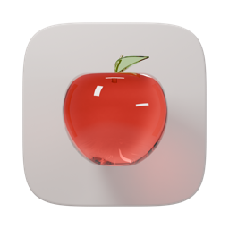
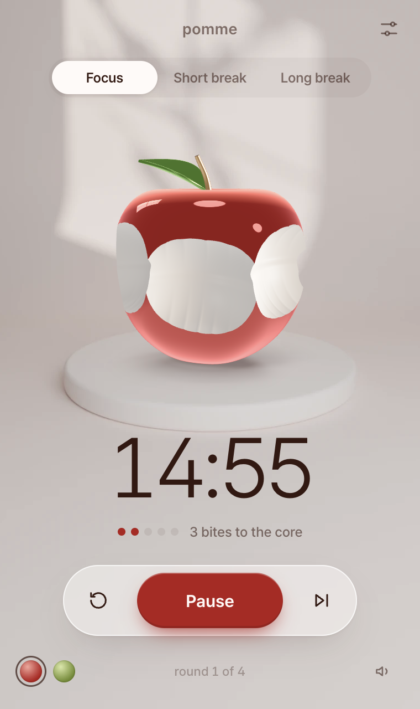
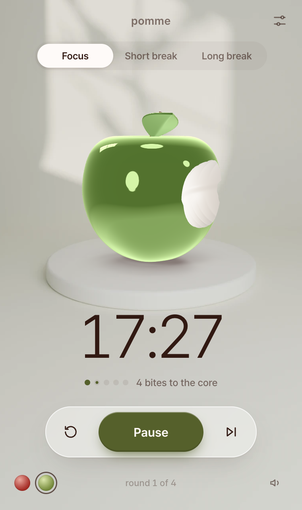
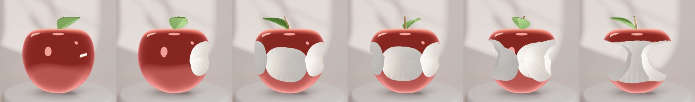
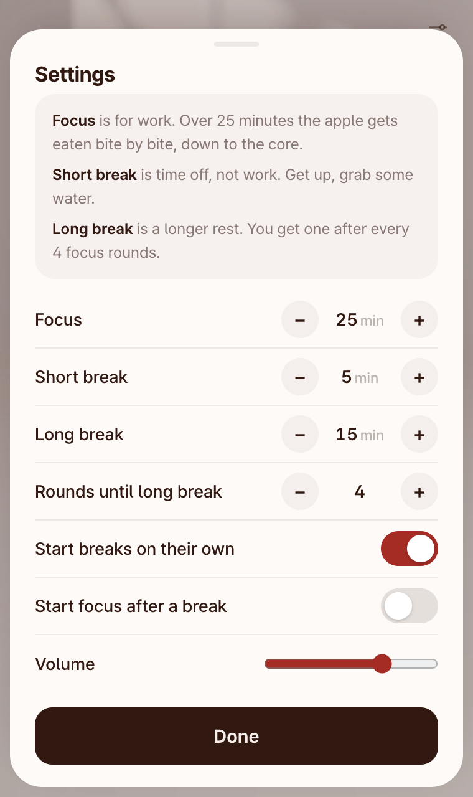

<p align="center">
  
</p>

<h1 align="center">Pomme</h1>

<p align="center">A pomodoro timer for Mac and Windows. An apple gets eaten while you focus.</p>

<p align="center">
  <a href="https://github.com/CyberOil1997/pomme/releases/latest"><b>Download</b></a>
</p>

<p align="center">
  
  &nbsp;
  
</p>

## How it works

Focus sessions are 25 minutes. Every 5 minutes the apple takes another bite, and by the end it's just the core. Then you get a 5 minute break. After 4 rounds the break is 15 minutes instead. You can change any of these in settings.

<p align="center">
  
</p>

You can drag the apple to spin it. The time also shows in the menu bar (or the system tray on Windows), so you can close the window and it keeps running. There's a red apple and a green one.

Shortcuts: `Space` start/pause, `R` reset, `S` skip, `1` `2` `3` to switch modes.

<p align="center">
  
</p>

## Download

Get the latest version from [Releases](https://github.com/CyberOil1997/pomme/releases/latest).

**Mac:** download the `.dmg`, open it and drag Pomme into Applications. It isn't notarized yet, so the first time you open it, right-click Pomme in Applications and choose Open.

**Windows:** download the `Pomme-Setup` .exe and run it. It isn't signed yet, so Windows may show a SmartScreen warning. Click "More info" and then "Run anyway".

## How it's made

The apple and the room behind it are modeled and rendered in Blender. [`blender/apple.py`](blender/apple.py) builds all of it:

```sh
blender -b -P blender/apple.py -- --mode export --out export
blender -b -P blender/apple.py -- --mode backdrop --color red --res 2400 --samples 64 --out backdrop
blender -b -P blender/apple.py -- --mode backdrop --color green --res 2400 --samples 64 --out backdrop
```

The app is built with Electron, and the apple is drawn with three.js. The sounds are made with Web Audio, except the crunch, which was made with Higgsfield. The font is [Pretendard](https://github.com/orioncactus/pretendard).

## Building

```sh
cd app
npm install
npm start           # run it
npm run dist        # Mac .dmg
npm run dist:win    # Windows installer
```

## License

MIT
